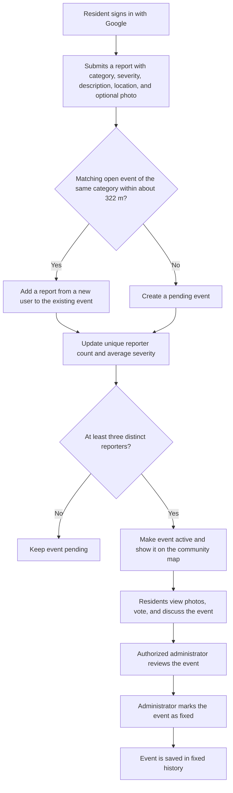

  

# Kinship

Community reporting, shared awareness, and local issue resolution.

Created for the 2026 Congressional App Challenge · Android application and web administrator dashboard

Kinship is a civic reporting application that helps residents discover problems in their neighborhoods, report what they see, and follow issues as they gain community attention. Instead of treating every submission as an unrelated complaint, Kinship groups reports of the same type in the same area into a shared event. Community members can add evidence and discussion, while an authorized administrator can review active events and mark resolved issues as fixed.

Kinship has two connected interfaces:

- Kinship for Android: a native mobile application for residents to explore, report, discuss, and track local issues.
- Kinship Admin: a web dashboard for reviewing community events and recording when they have been resolved.

Both interfaces use Firebase Authentication and Cloud Firestore. The Android application also integrates Google Maps, Cloudinary image uploads, and a local news feed. The admin dashboard uses Leaflet and OpenStreetMap.

## Contents

- [Install Kinship on an Android phone](#install-kinship-on-an-android-phone)
- [Access the admin panel](#access-the-admin-panel)
- [How the reporting system works](#how-the-reporting-system-works)
- [Android app features](#android-app-features)
- [Administrator dashboard](#administrator-dashboard)
- [Technology stack](#technology-stack)
- [Credits and acknowledgments](#credits-and-acknowledgments)
- [Congressional App Challenge](#congressional-app-challenge)
- [License](#license)

## Install Kinship on an Android phone

Kinship supports Android 9 (API 28) and later. You can download the Android installation file (APK) from the official [Kinship GitHub Releases page](https://github.com/mike123ike/Kinship/releases/latest). You do not need Android Studio or the project source code to install the app.

1. On your Android phone, open the [latest Kinship release](https://github.com/mike123ike/Kinship/releases/latest) on GitHub.
2. Find the Assets section (expand it if necessary) and download the file ending in `.apk`. Do not choose the source code ZIP or TAR archive.
3. Open the downloaded APK from your browser's Downloads page or the Files app.
4. If Android asks to allow installation from your browser or file manager, follow the prompt to permit it for that source. The wording varies by Android version.
5. Tap Install, then Open once installation finishes.
6. Choose Sign in with Google and select your account. Grant location, camera, or photo permissions when you want to use features that require them.

The installation file is distributed through the project's GitHub Releases, not through the source code ZIP. After installing, you can turn off the temporary permission to install unknown apps.

## Access the admin panel

The Kinship administrator dashboard is hosted on [Render](https://render.com/) and is available online at [kinship-iqth.onrender.com](https://kinship-iqth.onrender.com/). Nothing needs to be installed.

1. Open the link in a modern web browser on your computer, tablet, or phone.
2. Sign in with the administrator username and password provided by the Kinship team. Regular Android app accounts do not automatically have administrator access.
3. Use the dashboard to review active community events, examine photos and comments, filter or search events, and mark resolved issues as fixed. Previously fixed events remain available in the history view.

The dashboard is restricted to authorized administrators and uses the same Firebase data as the Android app.

## How the reporting system works

### Firestore data organization

The Android and web apps interact with the following key Firestore paths:

| Collection / path | Purpose |
| --- | --- |
| `users/{uid}` | Account profile, preferences, and protected admin role flags |
| `users/{uid}/importantLocations/{locationId}` | The user's saved Home, Work, School, and custom places |
| `reports/{reportId}` | Individual user submissions and their associated event IDs |
| `events/{eventId}` | Aggregated community issue, status, severity, counts, map coordinates, photos, and resolution information |
| `events/{eventId}/comments/{commentId}` | Discussion threads, timestamps, anonymity settings, and heart counts |
| `events/{eventId}/votes/{uid}` | Individual users' upvotes and downvotes |

The Android app and the web dashboard use the same Firebase backend.

## Android app features

### 1. Signing in with Google

- Users sign in with their Google accounts through Android Credential Manager and Firebase Authentication.
- When users first sign in, Kinship creates a corresponding user profile in Firestore.
- Returning users can access their existing reports, saved places, and preferences.
- The app displays the user's Google profile name and, when available, profile photo.
- Actions that create or change community data are associated with an authenticated account, even when a user chooses anonymous public display.

### 2. Interactive community map

The Map section is the main way to explore local issues:

- Displays geolocated, publicly active events on a Google Map.
- Loads events around the map's visible region using Firestore queries based on geohashes.
- Uses category symbols and visual styling based on severity to distinguish problems.
- Lets users pan, zoom, explore event markers, and center the map on their location.
- Selecting a marker opens an event preview with its category, severity, photos, location, report count, voting controls, and community conversation preview.
- Users can open a full photo gallery or comment view from the event preview.
- Saved important locations can also appear as markers, with their own information display.
- Supports light and dark map styling alongside the app's theme preference.

### 3. Community issue reporting

The Report section allows an authenticated user to submit a firsthand observation:

| Field | Behavior |
| --- | --- |
| Category | Road, Lighting, Hazards, Vandalism, Safety, or Other |
| Severity | A rating chosen by the user from 1 to 10 (1 = minor; 10 = potentially life threatening) |
| Description | Written context explaining the issue |
| Photo | Optional image taken with the camera or chosen from the device's photo library |
| Location | Current GPS position or a point chosen through the interactive map picker |

When an image is attached, Kinship uploads it to Cloudinary and associates the resulting image URL with the report. Reports without an image can also be submitted. Map coordinates and a geohash are stored for geographic searching.

Related reports are automatically grouped. Rather than always creating a new event, the app looks for an existing event with the same category within approximately 322 meters (0.2 miles). If it finds an eligible event, it adds the new report to that event; otherwise, it creates a new event. A user cannot contribute multiple reports to the same event. Firestore transactions help keep counts and aggregate severity consistent when several reports arrive close together.

### 4. Shared events and community confirmation

Kinship distinguishes between a report (one person's submission) and an event (the shared issue those reports describe).

- A newly created event starts as `PENDING`.
- Once three distinct user accounts have reported that event, it becomes `ACTIVE` and is publicly visible on the community map.
- An active event aggregates the number of reports and unique reporters, the average severity rating, and submitted photos.
- Additional reports can strengthen the shared record without making duplicate markers for the same issue.
- Previously fixed events are retained as historical records and are not matched as open issues by the reporting flow.

This is community corroboration, not automatic verification that a report is true. Reports, ratings, and discussions are contributed by users.

### 5. Event voting and discussions

Users can engage with a shared event rather than only viewing it:

- Upvote or downvote an event, with a displayed net vote score.
- Change or remove an existing vote; each account has its own vote record.
- Open a Comments screen to read and post comments about the event.
- Sort comments by Top or Newest.
- Add a heart to comments and remove that reaction later.
- Load additional comments through pagination when more comments are available.
- Write comments of up to 1,000 characters.
- See a highlighted community comment and total comment count in the event preview when available.
- Display comments anonymously when the user's anonymous reporting preference is enabled.

Community discussion helps residents share context and updates. It is not a substitute for contacting emergency personnel or the appropriate public agency.

### 6. Events: Near My Places

The Events section includes a Near My Places view, which focuses on concerns near locations important to the user:

- Shows events that are active or still in progress within approximately 3 miles of saved locations.
- Allows the user to view events near all saved places or filter to a specific location.
- Offers sorting by Most Recent, Severity, Closest, and Most Reports.
- Event cards summarize the type of problem, severity, proximity, reporting activity, and relevant timestamps.
- Selecting an event takes the user to its location and details on the map.

### 7. Events: Local News

The Local News view complements events submitted by the community with reporting from external news publishers:

- Uses the device's precise location to establish a local news area.
- Retrieves recent, relevant U.S. news through NewsData.io.
- Focuses on civic and topics of public interest such as public safety, traffic, utilities, severe weather, and environmental concerns.
- Shows headlines, article summaries when available, publishers, and relative publication times.
- Opens the original publisher's article when a story is selected.

The news integration currently selects the nearest configured major U.S. city for its search, so the returned stories may cover a wider metropolitan area rather than the user's exact municipality. The news feed depends on an external API key, location access, and the provider's availability.

### 8. Profile and report history

The Profile section gives users a personalized summary of their involvement:

- Displays their account identity and profile picture.
- Shows totals for reports submitted and events marked fixed that are associated with those reports.
- Provides previews of their reports and a View All option.
- Separates report history into active/unresolved and fixed views based on the related event's status.
- Shows saved important locations and provides ways to manage them.

### 9. Important locations

Users can save places that matter to them, rather than checking only their current GPS position:

- Preset locations: Home, Work, and School.
- Additional locations with names chosen by users.
- A map picker for choosing locations and displaying their addresses.
- Add, edit, and remove saved locations.
- Use those places to populate the Near My Places events feed and optional map markers.

Saved places are associated with the user's Firestore account and are not intentionally displayed in public event records. Access control still depends on correctly configured Firestore security rules.

### 10. Settings, accessibility, and privacy controls

- Dark mode and a saved appearance preference.
- Anonymous reporting toggle. This hides the user's identity from other community members in applicable report/comment views while the backend retains an account association for integrity.
- Permission management for device settings such as location and camera access.
- Community safety guidance about factual reporting, respectful comments, and avoiding disclosure of others' personal information.
- Terms, Privacy Policy, Credits, Support, and Log out controls within the app.

## Administrator dashboard

Kinship Admin is a separate, web interface for authorized administrators. It connects to the same Firebase project as the Android app and is hosted on Render at [kinship-iqth.onrender.com](https://kinship-iqth.onrender.com/).

### Administrator login and access control

- A dedicated username + password form is shown when the admin page opens.
- An administrator username is associated with an authorized Firebase Authentication account.
- Firebase Email/Password Authentication checks the submitted password; the project does not contain a plaintext password or a custom password database.
- After authentication, the dashboard verifies that the account's `users/{uid}` Firestore document has `admin: true` and is not `deleted: true`.
- Authentication uses browser session persistence; the session is designed to end when the browser session closes.
- Only accounts assigned the administrator role may access the dashboard.

### Live event dashboard

After signing in, an administrator can:

1. Review summary cards for Active events, events with an average severity of 8 or higher, and Fixed events.
2. Switch between Active events and Fixed history.
3. Inspect an interactive Leaflet and OpenStreetMap map with event markers styled according to severity.
4. Search events by category or event ID.
5. Filter the queue by one of the six report categories.
6. Sort by highest severity, newest, most reports, or recently fixed.
7. Select an event in the queue and focus its map marker.
8. Open detailed event information, including its average severity, number of reports and distinct reporters, vote score, timestamps, and location.
9. Browse event photos in a carousel and expanded gallery.
10. Read current event comments. The admin panel does not allow posting or editing comments.
11. Look up a readable address from event coordinates, where available.
12. View connection status and refresh when data is unavailable.

The panel uses live Firestore snapshot listeners to reflect changes without manually reloading the page in normal operation. Cached/offline and connection error states are shown when appropriate.

### Marking an event as fixed

An administrator can open an `ACTIVE` event, choose Mark as Fixed, and confirm the action in a second dialog. The dashboard then runs a Firestore transaction that:

- Confirms that the administrator's role is still valid.
- Confirms that the event still exists and is active.
- Changes the event's status to `FIXED`.
- Records `resolvedBy` (the admin's Firebase user ID), `resolvedAt`, and `updatedAt`.
- Moves the event into Fixed history, where its resolution record can be viewed but not edited.

A previously fixed event cannot be fixed a second time. The current panel does not include reopening events, editing reports, deleting content, sending messages to residents, or creating separate city administrator workspaces. It displays whichever active and fixed events the authorized account can read under the deployed Firestore rules.

### Admin map and address services

Unlike the Android application, the web dashboard does not use the Google Maps JavaScript API. It uses:

- Leaflet 1.9.4 for the interactive browser map.
- OpenStreetMap tiles and their required attribution.
- Nominatim reverse geocoding for optional lookups of street addresses from coordinates, with browser caching and rate limiting.

## Technology stack

| Component | Technologies |
| --- | --- |
| Android app | Java, Android SDK, XML layouts, Gradle Kotlin DSL |
| Mobile UI | AndroidX, Material Components, AppCompat, Fragments, CardView, ConstraintLayout |
| Authentication | Firebase Authentication, Google Identity Services, Android Credential Manager |
| Database and updates | Cloud Firestore, snapshot listeners, queries, atomic batches, transactions |
| Android maps and location | Google Maps SDK for Android, Google Play services Location, Android Geocoder |
| Geographic matching | GeoFire for geohashes, geographic bounds, and distance calculations |
| Images | Cloudinary Android SDK, Glide; Coil is also declared as a dependency |
| News | NewsData.io API |
| Web admin frontend | HTML, CSS, JavaScript ES modules |
| Admin panel hosting | Render |
| Web admin maps | Leaflet 1.9.4, OpenStreetMap, Nominatim |
| Web authentication and database | Firebase Web SDK 13.0.0 (loaded from Google's CDN) |
| Local admin development | Node.js HTTP server; Prettier for formatting |

The Gradle build also declares Firebase Analytics, Firebase Storage, Jetpack Compose, and Navigation Compose dependencies. Their presence in a dependency list does not mean every feature is implemented with them; the current Android screens are primarily Java/XML, and the report photo upload path uses Cloudinary.

## Credits and acknowledgments

### Project team

Kinship was created as a student project for the 2026 Congressional App Challenge.

Developed by: Taige L, Rohan J, Julian L, Krish M

### Libraries, frameworks, and services

The following credits are based on dependencies, source imports, service endpoints, and bundled licenses visible in the repository.

| Tool, framework, or provider | How Kinship uses it |
| --- | --- |
| [Android / Android SDK](https://developer.android.com/) and [Android Studio](https://developer.android.com/studio) | Native mobile platform, activity/fragment lifecycle, device permissions, and development environment |
| [Java](https://www.oracle.com/java/) and [Gradle](https://gradle.org/) / [Kotlin DSL](https://docs.gradle.org/current/userguide/kotlin_dsl.html) | Android implementation and build configuration |
| [AndroidX](https://developer.android.com/jetpack/androidx) and [Material Components for Android](https://github.com/material-components/material-components-android) | App UI components, navigation framework, cards, layouts, and appearance |
| [Google Identity Services](https://developers.google.com/identity) and [Android Credential Manager](https://developer.android.com/identity/sign-in/credential-manager) | Google account sign in |
| [Firebase Authentication](https://firebase.google.com/docs/auth) | Android Google authentication and administrator email/password authentication |
| [Cloud Firestore](https://firebase.google.com/docs/firestore) | Reports, events, user profiles, comments, votes, live updates, and resolution transactions |
| [Firebase Analytics](https://firebase.google.com/docs/analytics) | Declared as an Android dependency |
| [Firebase Storage](https://firebase.google.com/docs/storage) | Declared as an Android dependency; report photos in the reviewed path are uploaded to Cloudinary |
| [Firebase JavaScript SDK](https://firebase.google.com/docs/web/setup) | Web administrator authentication, database access, and live event subscriptions |
| [Google Maps Platform](https://developers.google.com/maps/documentation/android-sdk) | Android community map and map based location pickers |
| [Google Play services Location](https://developers.google.com/android/reference/com/google/android/gms/location/package-summary) | Device location access |
| [GeoFire](https://github.com/firebase/geofire-android) | Geohash queries, nearby event matching, and distance checks |
| [Cloudinary](https://cloudinary.com/) | Uploading and hosting optional report images |
| [Glide](https://github.com/bumptech/glide) | Loading photos and images in the Android interface |
| [Coil](https://coil-kt.github.io/coil/) | Declared Android image loading dependency |
| [NewsData.io](https://newsdata.io/) | Local news headlines, article metadata, and publisher links from an external provider |
| [Leaflet](https://leafletjs.com/) | Interactive web administrator map (v1.9.4, bundled in `admin-panel/dist/vendor/leaflet/`) |
| [OpenStreetMap](https://www.openstreetmap.org/copyright) contributors | Admin dashboard map data/tiles and related attribution |
| [Nominatim](https://nominatim.org/) | Admin reverse geocoding, subject to [OSMF's public service policy](https://operations.osmfoundation.org/policies/nominatim/) |
| [Render](https://render.com/) | Hosts the publicly accessible Kinship admin panel website |
| [Node.js](https://nodejs.org/) | Local static file server used during admin development |
| [Prettier](https://prettier.io/) | Admin code formatting (v3.9.9 in `package-lock.json`) |
| [Jetpack Compose](https://developer.android.com/compose) and [Navigation Compose](https://developer.android.com/jetpack/compose/navigation) | Declared build dependencies; the implemented resident screens are mainly Java/XML |

Leaflet license: The included Leaflet library is distributed under the BSD 2-Clause License. Its full notice, including the copyright holders Volodymyr Agafonkin and CloudMade, is preserved in [`admin-panel/dist/vendor/leaflet/LICENSE`](admin-panel/dist/vendor/leaflet/LICENSE). Keep that notice when redistributing the vendored files.

Map data: OpenStreetMap data has its own licensing and attribution requirements; follow the [OpenStreetMap copyright and license page](https://www.openstreetmap.org/copyright). The admin map displays attribution to map contributors.

Other dependencies: For exact dependency declarations and versions, see [`app/build.gradle.kts`](app/build.gradle.kts), [`gradle/libs.versions.toml`](gradle/libs.versions.toml), [`admin-panel/package.json`](admin-panel/package.json), and [`admin-panel/package-lock.json`](admin-panel/package-lock.json). Upstream licenses remain applicable.

## Congressional App Challenge

Kinship was developed for the 2026 Congressional App Challenge (CAC), a student coding competition organized through participating offices of the U.S. House of Representatives. Our goal is to demonstrate how an application can use shared community reports, geographic organization, and straightforward administrative tools to make community concerns more visible and easier to follow.

- [Congressional App Challenge official website](https://www.congressionalappchallenge.us/)
- [2026 competition rules and information](https://www.congressionalappchallenge.us/students/rules/)

## License

Kinship's original source code is released under the [MIT License](LICENSE). You may use, modify, and distribute the original code as permitted by that license, provided you retain the copyright and license notice. The license includes a disclaimer of warranty.

Libraries, services, map data, third party content, and artwork retain any separate licenses, terms, and attribution requirements listed in the credits above. The MIT License does not replace those requirements.
